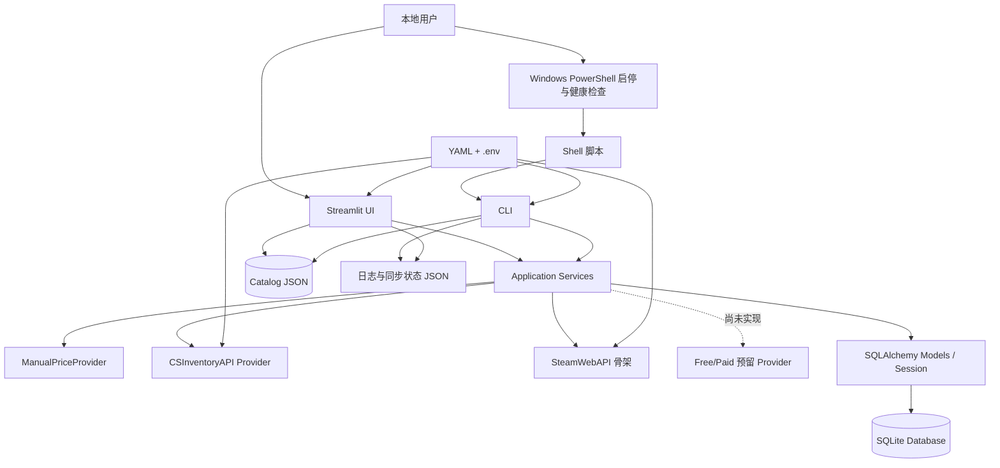

# CS2 Price Monitor 项目开发日志

## 1. 文档说明

### 1.1 文档用途

本文档是一份可长期维护的“项目开发日志 + 项目现状说明”，用于回答以下问题：

- 项目最初要解决什么问题；
- 从现有记录能够确认哪些开发阶段；
- 各阶段实现了什么、解决了什么问题、还留下了什么限制；
- 当前代码、数据库、运行脚本、部署方式和测试处于什么状态；
- 哪些结论来自 Git，哪些只是根据当前代码、测试、日志或部署文件推断。

本文档不记录任何 API Key、Token、Cookie、密码或 `.env` 的实际值。环境变量只记录名称或用途。

### 1.2 信息来源与可信度

本次梳理于 **2026-07-16（America/New_York）** 完成，检查范围包括：

1. Git：`git log --all --reverse`、全部 refs、分支、reflog、提交统计、当前工作区状态，以及唯一提交中的 README 和重要代码；
2. 当前项目：`README.md`、`pyproject.toml`、`requirements.txt`、`.env.example`、`config/app.yaml`、`src/`、`scripts/`、`tests/`、`data/`、应用入口和 CLI；
3. 数据库：SQLAlchemy 模型、自定义 SQLite 迁移，以及以只读方式核对现有 SQLite 表结构；未读取用户交易、持仓或价格记录内容；
4. 运行与部署：项目内 Shell 脚本、系统级 systemd service/drop-in、Windows PowerShell 启停脚本；
5. 运行证据：现有 Streamlit 和每日同步日志、core dump 元数据；日志内容仅用于识别故障类型和同步结果，未将敏感配置写入本文；
6. 测试：禁用 pytest 缓存和 `.pyc` 后进行本地只读环境测试。

本文采用以下标记原则：

- **Git 明确记录**：能够由提交日期、提交内容或提交 diff 直接确认；
- **运行记录确认**：能够由现有日志或 core dump 直接确认，但不等同于 Git 提交记录；
- **根据当前代码推断**：功能在当前工作区代码中存在，但 Git 历史没有对应提交，具体开发日期无法确认；
- **未确认**：没有足够证据，不把它写成既成事实。

### 1.3 Git 历史边界

当前仓库的 Git 历史非常短：

- 当前分支：`master`；
- 当前 HEAD：`f09211e6096da15acd5b0d4fff533dc6f953fc6e`；
- 唯一提交：**2026-07-12 10:19:04 -04:00**，`Prepare CSInventoryAPI integration framework`；
- 该提交一次性加入 45 个文件、约 3,605 行，因此 Git 无法还原提交前的逐日开发过程；
- 未发现其他本地分支、远程分支、tag 或 Git remote；reflog 也未提供更早提交；
- 当前大量后续功能仍未提交。Git 对这些功能只能说明“相对 HEAD 的当前工作区变化”，不能提供可靠的开发先后和日期。

因此，只有阶段一具有明确 Git 日期。其他阶段主要按代码依赖关系、功能演进逻辑、测试和运行日志组织；未能确认的日期均明确标注。

## 2. 项目概述

### 2.1 项目要解决的问题

CS2 Price Monitor 是一个本地运行的 CS2 饰品价格与投资组合管理工具。它把以下原本分散的工作集中到一个应用中：

- 维护关注饰品；
- 手工或通过外部 Provider 记录价格快照；
- 保存历史价格并生成每日 OHLC 和中位数；
- 记录买入、卖出，计算持仓、成本和收益；
- 录入没有完整历史交易的现有库存；
- 在 Streamlit 中查看组合、单品走势、告警和数据质量；
- 通过 CLI 和脚本执行一次性批量同步。

项目明确不做爬虫和自动交易。当前设计面向单机、本地 SQLite 和个人/小规模投资组合使用；代码中没有多用户、登录、权限或云端部署能力。

### 2.2 目标用户与核心用途

根据 README 和当前 UI 推断，目标用户是希望在本地管理 CS2 饰品关注列表、交易历史、现有库存与价格变化的个人用户。核心用途不是交易执行，而是数据记录、估值、分析和同步状态观察。

### 2.3 当前技术栈

- Python：项目要求 `>=3.12`；当前验证环境为 Python 3.12.13；
- UI：Streamlit，当前环境版本 1.59.1；
- 数据库：SQLite + SQLAlchemy 2.x；
- 数据处理：pandas；
- 图表：当前单品分析实际使用 Matplotlib；`plotly` 仍在依赖列表，但当前 UI 已不再导入；
- HTTP：httpx；
- 配置：python-dotenv + PyYAML；
- 调度骨架：APScheduler；
- 测试：pytest。

依赖文件只给出最低版本，没有 lock file，因此不同时间安装可能得到不同的依赖组合。

### 2.4 当前运行环境

检查时可确认的运行环境为：

- Windows 主机上的 WSL2；
- WSL 发行版：Ubuntu 26.04 LTS；
- Linux 内核带 `microsoft-standard-WSL2` 标识；
- 项目目录：`/home/zbw21/projects/cs2-price-monitor`；
- 当前 systemd service 的 drop-in 使用 `.venv312`；
- 另有脚本仍使用 `.venv`，存在虚拟环境路径不统一问题；
- Streamlit 固定端口为 `8502`，headless，file watcher 关闭。

Windows 11 这一主机版本来自项目任务上下文；本次只在 WSL 内确认了 WSL2 和 Ubuntu 版本，没有额外读取 Windows 系统版本。

## 3. 最初的项目需求

唯一 Git 提交中的代码和 README 可以确认，项目启动阶段已经包含以下目标：

- 维护 CS2 饰品列表，支持新增、修改、启用和禁用；
- 手动录入最低挂单价、最高求购价、挂单量、币种和时间；
- 每次录入保存独立价格快照；
- 从正常价格生成每日 OHLC、中位数和快照数；
- 记录买入和卖出；
- 使用移动加权平均成本维护持仓；
- 计算已实现收益、挂单估值、快速变现估值和未实现收益；
- 对超过上一正常价 3 倍或低于其三分之一的价格标记为可疑并生成告警；
- 排除可疑价格以及不兼容币种，避免错误估值和涨跌幅；
- 提供 Streamlit 页面；
- 支持价格与交易 CSV 导入、价格历史 CSV 导出；
- 抽象统一的 `PriceProvider` / `PriceQuote`；
- 为 CSInventoryAPI 和 SteamWebAPI 建立可配置接入骨架；
- 在 `manual`、`api`、`hybrid` 三种模式间切换；
- 批量同步时隔离单个饰品失败，不让整个批次中断。

以下能力不是初始提交已经完成的内容，而是当前未提交工作区中的后续扩展：完整 Item Catalog、手动期初库存、交易编辑/删除、交易审计、自定义 SQLite 迁移、一次性同步 CLI、同步状态文件、重试、并发锁和 Arrow 崩溃回避。

## 4. 开发环境与基础架构

### 4.1 Windows 11、WSL2 与虚拟环境

项目代码位于 WSL2 的 Linux 文件系统，而 Windows 侧保留 PowerShell 快捷脚本。这种结构让数据库和 Python 运行在 Linux 侧，Windows 侧只负责启动 WSL 服务、检查 Streamlit 健康端点并打开浏览器。

当前发现两个虚拟环境路径：

- `.venv312`：systemd drop-in 和本次测试使用，Python 3.12.13；
- `.venv`：`scripts/daily_sync.sh` 和 `start_streamlit_on_demand.sh` 使用；历史崩溃日志显示它曾运行 Python 3.14 环境。

这两个路径没有统一，是当前运维风险之一。

### 4.2 包结构与分层

当前主要包结构如下：

- `ui/streamlit_app.py`：页面、表单、展示和交互；
- `services/`：饰品、价格、同步、交易、分析、导入导出、手动持仓、迁移和自动同步状态；
- `providers/`：统一报价接口、手动 Provider、CSInventoryAPI、SteamWebAPI 及预留 Provider；
- `catalog/`：Catalog 数据模型、加载、搜索、导入、标准化和打包 JSON；
- `models.py`：SQLAlchemy 模型；
- `db.py`：engine、session factory、建表；
- `config.py`：YAML、`.env` 和路径解析；
- `cli.py`：数据库、诊断、同步和 Catalog 命令；
- `scheduler.py`：每日价格汇总的 APScheduler 构造函数。

项目**没有独立 repository 层**。service 和部分 UI 直接使用 SQLAlchemy `Session` 查询模型，因此当前实际分层是 UI/CLI → service → SQLAlchemy model/session → SQLite，而不是严格的 UI → service → repository → database。

### 4.3 应用入口、CLI 与脚本

应用入口是 `src/cs2_price_monitor/app.py`，只调用 `ui.streamlit_app.main()`。

当前 CLI 命令包括：

- `init-db`：创建缺失表；
- `migrate-db`：执行自定义、幂等的 SQLite schema 迁移；
- `diagnose-transaction-quantities`：只读列出不符合正整数规则的历史交易数量；
- `sync-all`：执行一次外部价格同步、重试、提交结果并写状态 JSON；
- `catalog import`：导入并标准化 JSON/CSV Catalog；
- `catalog stats`：输出 Catalog 统计。

项目内脚本包括：

- `scripts/daily_sync.sh`：加文件锁、降低进程优先级、运行一次 `sync-all` 并写日志；
- `scripts/keep_streamlit_alive.sh`：启动 systemd service，并用前台 WSL 进程保持发行版存活；
- `start_streamlit_on_demand.sh`：不经 systemd 直接启动固定端口 Streamlit，并避免重复实例。

## 5. 按时间顺序记录开发过程

### 阶段一：项目初始化

**时间或提交范围**

- Git 明确记录：2026-07-12；
- 提交：`f09211e`，`Prepare CSInventoryAPI integration framework`；
- 更早历史不存在，因此无法确认提交前每项功能的具体完成日期。

**当时的目标**

建立一个能够本地运行的最小完整系统：数据模型、手动价格、交易/持仓、分析、Streamlit 页面、CSV、Provider 抽象和测试一次到位。

**完成的工作**

- 建立 Python 包、配置加载、SQLite engine/session 和应用入口；
- 建立 6 张核心表：`items`、`transactions`、`holdings`、`price_snapshots`、`daily_price_summaries`、`alerts`；
- 实现饰品新增、启停和元数据修改；
- 实现手动报价、价格快照、异常价格检测、告警和每日汇总；
- 实现买入、卖出、移动加权平均成本、已实现收益和超卖保护；
- 实现组合估值、单品走势、移动平均、涨跌幅和买卖价差；
- 建立 6 个 Streamlit 页面：投资组合、饰品管理、每日价格、交易记录、单品分析、告警与数据质量；
- 实现价格/交易 CSV 导入和价格导出；
- 建立 `PriceProvider`、`PriceQuote`、manual、CSInventoryAPI、SteamWebAPI、free/paid 预留结构；
- 建立 45 个项目文件和初始测试。

**主要修改文件**

`README.md`、`pyproject.toml`、`config/app.yaml`、`src/cs2_price_monitor/` 全部基础模块，以及最初的 `tests/`。

**当时的限制**

- CSInventoryAPI 只有请求/认证/解码边界，真实响应映射会主动抛出 `ApiSchemaNotConfiguredError`；
- SteamWebAPI 只有可配置骨架和 synthetic fixture；
- free/paid Provider 直接抛出 `NotImplementedError`；
- 交易只能创建，不能编辑或删除；
- 饰品靠手工填写，没有独立 Catalog；
- 没有手动期初库存；
- `init-db` 只能建表，没有旧数据库迁移；
- APScheduler 只构造每日汇总任务，没有在应用入口启动；
- 没有自动 API 定时同步。

**阶段结束状态**

初始提交已经形成可运行的手动价格和投资组合 MVP，但外部实时价格、现有库存导入、历史交易维护和稳定部署仍未完成。

### 阶段二：数据库和价格数据

**时间或提交范围**

- 基础模型和价格逻辑属于 2026-07-12 的唯一提交；
- 迁移、可空价格字段、币种唯一性、手动库存表和交易审计表属于当前未提交工作区；具体开发日期无法确认。

**数据库表与职责**

| 表 | 当前职责 | 状态 |
|---|---|---|
| `items` | 本地监控饰品、中文/BUFF 名、分类、启停 | 已实现 |
| `transactions` | 买卖、数量、单价、手续费、交易/创建/更新时间 | 已实现 |
| `transaction_audit_logs` | 交易 UPDATE/DELETE 前后 JSON 审计 | 当前未提交实现 |
| `holdings` | 从交易历史重算的数量、平均成本、已实现收益 | 已实现 |
| `manual_holdings` | 没有完整交易历史的期初/手动库存 | 当前未提交实现 |
| `price_snapshots` | Provider 报价、币种、时间、可疑标记、原始响应 | 已实现并扩展为允许部分字段为空 |
| `daily_price_summaries` | 按物品、日期、币种的 OHLC、中位数和样本数 | 已实现 |
| `alerts` | 数据质量告警及预留解决状态 | 已实现生成/展示；解决操作未实现 |

本次以只读方式检查现有 `data/cs2_monitor.sqlite3`，上述 8 张表都已存在，当前列结构与自定义迁移目标一致。没有读取表中的业务数据。

**价格数据处理**

- 所有报价先转换为统一 `PriceQuote`，再由 `record_price_quote()` 持久化；
- 当前报价允许最低挂单价、最高求购价和挂单量为 `None`，避免用零伪造 API 缺失值；
- 可疑检测只比较同币种的上一条正常最低挂单价；
- 大于上一正常价 3 倍或小于上一正常价三分之一时，快照保留但标记可疑，同时创建 warning 告警；
- 可疑快照不进入正常估值、涨跌幅和每日汇总；
- 每日汇总按 `item_id + date + currency` 分组，计算 OHLC、中位数和数量。

**问题与解决方案**

1. 旧 schema 中价格字段可能是 `NOT NULL`，不能保存 API 的部分数据。当前迁移通过重建 `price_snapshots` 放宽三个价格/数量字段，并保留原数据和索引。
2. 早期每日汇总没有币种列。当前迁移增加 `currency`，并建立物品、日期、币种唯一索引。
3. `create_all()` 不能更新已有表。当前增加 `migrate_sqlite_schema()`，处理上述 schema、手动库存、交易 `updated_at` 和审计表，且有幂等测试。
4. 配置从非项目目录运行时可能解析到错误的 `.env`、YAML 或相对数据库路径。当前 `config.py` 以 `PROJECT_ROOT` 为基准解析。

**当前仍存在的问题**

运行日志在 **2026-07-16 05:28:45 -04:00** 记录了 `sqlite3.OperationalError: database is locked`。触发点是投资组合页面加载时调用 `regenerate_daily_summaries()`，该函数会先删除整张每日汇总表；它与同步写入并发时可能争抢 SQLite 写锁。当前代码未配置 busy timeout、WAL、进程级数据库写锁，也没有把全量重算改为增量更新，因此此问题不能视为已经解决。

**阶段结束状态**

数据模型和迁移覆盖已经较完整，实际数据库也已迁移到当前结构；但页面读取路径中仍包含全表删除/重建写操作，SQLite 并发稳定性是当前主要缺口。

### 阶段三：外部价格 Provider

**时间或提交范围**

- 2026-07-12 Git 提交：通用 Provider、manual、CSInventoryAPI/SteamWebAPI 骨架；
- 当前未提交工作区：CSInventoryAPI 真实 schema 映射和配置默认值；
- 运行日志可确认 2026-07-12 和 2026-07-14 已有成功批量同步，但无法据此确定代码修改提交时间。

**通用架构**

`PriceProvider.get_quote(item_id)` 返回统一 `PriceQuote`。Provider factory 根据 `manual`、`api`、`hybrid` 模式和 Provider 名称创建实现。UI 和同步服务不解析供应商 JSON，保存仍统一经过价格服务。

**CSInventoryAPI 演变**

初始提交只实现：

- 可配置 base URL、endpoint template、认证 header/query；
- URL 占位符转义；
- HTTP 状态、timeout、传输错误和 JSON 对象校验；
- synthetic 测试适配器；
- 在真实 schema 未知时明确失败。

当前未提交代码已经实现真实报价映射：

- endpoint template：`/api/v2/prices/{market_name}`；
- query：认证参数名由配置提供，并追加 `source` 和 `app_id`；
- `sell_price_cents.<currency>` 转为最低挂单价；
- `buy_price_cents.<currency>` 转为最高求购价；
- `quantity` 转为挂单量；
- 分值除以 100 转为主币单位；
- 缺失价格或配置币种不存在时保留 `None`；
- 使用脱敏 HTTP 200 fixture 验证映射，并覆盖 401、403、429、500、timeout、无效 JSON 和缺失配置。

代码和 README 中记录了公开端点结构；本文不记录 API Key 或 `.env` 实际值。默认配置仍是 `manual`，真实同步必须由本地环境配置显式启用。

**真实数据接入证据**

现有 `daily_sync.log` 可确认：

- 2026-07-12 19:58 UTC：8 个饰品全部同步成功；
- 2026-07-14 05:37 UTC：19 个饰品全部同步成功；
- 日志还记录了多次因 `flock` 检测到已有同步进程而跳过的运行。

这说明 CSInventoryAPI 路径曾在当前环境中成功写入真实同步结果；本次梳理没有再次调用外部 API，不能保证当前密钥、账号额度或远端服务仍然可用。

**其他 Provider 状态**

- `ManualPriceProvider`：已完成，Streamlit 和 CSV 导入实际使用；
- `SteamWebApiProvider`：请求、错误和可配置字段路径已实现，但只有 synthetic fixture，仍依赖完整外部配置，不能写成生产接入完成；
- `FreeApiProvider`、`PaidApiProvider`：只有代码骨架，调用即 `NotImplementedError`；
- 无爬虫、无自动交易。

**阶段结束状态**

统一 Provider 架构已经落地，CSInventoryAPI 已从骨架推进到可用映射并有成功运行记录；可用性仍取决于本地配置和远端 API。其他外部 Provider 尚未达到真实生产接入状态。

### 阶段四：Streamlit 界面

**时间或提交范围**

- 初始 6 页 UI 属于 2026-07-12 提交；
- Catalog、手动库存、交易编辑/删除、稳定性和性能改动都在当前未提交工作区，具体日期无法由 Git 确认；
- Streamlit 日志能确认 2026-07-12 至 2026-07-13 发生过连续原生崩溃。

**当前页面结构**

1. **投资组合总览**：汇总挂单估值、快速变现估值、未实现收益，展示交易/手动/总持仓、已知与未知成本、24 小时/7 日/30 日变化，并提供快速添加饰品；
2. **手动库存管理**：从 Catalog 搜索并录入现有库存，支持成本可空、获得日期、来源、备注、启停、修改及转换为历史买入；
3. **饰品管理**：Catalog 搜索新增、元数据修改、启停，以及输入完整名称后二次确认的关联数据删除；
4. **每日价格录入**：显示一次性自动同步状态、API 批量同步、最新非手动 API 快照、手动报价和价格 CSV 导入；
5. **交易记录管理**：新建买卖、交易 CSV 导入、最近 200 条历史、编辑和删除；
6. **单品价格分析**：当前报价、涨跌幅、价差、交易持仓指标、价格/移动平均/可疑点图和每日汇总；
7. **告警和数据质量**：饰品启停、最近 200 条告警、最近 200 条可疑快照和价格历史导出。

**Item Catalog**

当前代码增加了独立于 `items` 表的 Catalog：

- 支持中文、英文、别名、version、大小写无关和忽略空格搜索；
- 搜索结果不会依赖本地数据库是否已经监控该物品；
- 支持 JSON/CSV 导入、字段映射、去重、类型归一化、统计和打包数据；
- 当前打包 `catalog_data.json` 实际有 **20,006** 条；导入报告为 19,570 个唯一 `market_hash_name`、552 条带 version；
- 20,000 条缺少中文名，只有少量人工补充中文名/别名；
- 测试要求 10,000 条 Catalog 搜索在 1 秒内完成。

当前 README 仍写着“内置文件只有 6 条箱子示例”，与实际 20,006 条打包数据不一致。这是文档陈旧，不应据此否定当前完整 Catalog 已存在。

**页面性能与连接稳定性问题**

现有日志和 core dump 可以确认，Streamlit 曾反复以 `SIGSEGV` 退出。日志栈明确落在 pandas Arrow string、Streamlit DataFrame Arrow 序列化和 `pyarrow` 原生库；现存 24 个 `core.*` 文件约占 3.5 GiB。崩溃在 `.venv` 的 Python 3.14 环境和 `.venv312` 的 Python 3.12 环境中都出现过，因此不能简单归因于单一 Python 大版本。

当前代码采取的解决方案包括：

- 禁止目标页面使用 `st.dataframe` / Arrow 表格组件，改用转义后的静态 HTML 表格或普通 Streamlit columns；
- 强制 pandas string storage 使用 Python 后端，并关闭 future string inference；
- 将单品 Plotly 图替换为 Matplotlib，展示后显式关闭 figure；
- 限制交易 200 条、单品快照 1,000 条、告警和可疑快照各 200 条；
- 为同步摘要、空数据、多次重复渲染和 systemd SIGSEGV 路径增加回归测试；
- 外部同步只在用户点击或 CLI 运行时发生，普通页面重复渲染测试明确禁止外部 API 调用。

这些改动有明确的代码和回归测试证据。日志中最后一次可见的 Arrow 相关崩溃发生在 2026-07-13；但因为改动尚未提交，也没有长期运行指标，本文只称其为“已实施回避和回归覆盖”，不宣称原生库问题已经永久根治。

**阶段结束状态**

UI 已从基础 6 页扩展为 7 页，并补齐 Catalog、手动库存和历史交易维护。性能和 Arrow 稳定性已做针对性改造，但数据库写锁是当前页面稳定性的另一条未解决路径。

### 阶段五：交易和库存管理

**时间或提交范围**

- 买入、卖出、交易持仓和移动加权平均成本属于 2026-07-12 初始提交；
- 交易编辑/删除、审计、整数数量、手动库存和相应迁移都未提交；具体日期无法确认。

**买入和卖出**

- 买入：`总成本 = 原数量 × 原平均成本 + 买入数量 × 单价 + 手续费`，再计算新平均成本；
- 卖出：收入按 `数量 × 单价 - 手续费`，已实现收益扣除对应平均成本；
- 卖出不会改变剩余平均成本，清仓后平均成本归零；
- 创建或重建持仓时不允许卖出超过当时持仓。

**历史交易编辑**

当前 UI 和 service 已支持修改：

- 饰品；
- 买入/卖出类型；
- 数量；
- 单价；
- 交易日期和时间；
- 备注。

保存前显示字段差异并要求二次确认；保存后按时间顺序重放旧、新两个受影响饰品的全部交易，重算库存、平均成本和已实现收益。修改交易日期、类型或饰品时，如果任一历史时点库存变负，操作会拒绝并回滚。

当前编辑接口和 UI**不支持修改手续费**；已有手续费在校验和重算中继续保留。此项属于部分完成，不应写成“交易所有字段均可编辑”。

**历史交易删除**

删除前显示交易摘要并要求确认。删除后重放该饰品剩余交易；如果删除一条买入会让后续历史库存变负，删除会拒绝。删除卖出则会恢复相应库存。

更新和删除都写入 `transaction_audit_logs`：UPDATE 保存 before/after，DELETE 保存 before 和空 after。审计表没有外键回连已删除交易，适合保留删除证据，但项目没有审计日志查看页面。

**数量字段规则**

- 新建和编辑的**交易数量**必须是大于等于 1 的有限正整数；
- UI 使用整数输入；service 不会把小数静默截断；
- `0`、负数、小数、布尔值、NaN、Infinity 都会拒绝；
- 对旧数据库中已经存在的小数/非法数量，UI 会警告并要求手工修复；CLI 可以只读诊断；
- 数据库列仍是 `NUMERIC(18, 6)`，整数规则由 service/UI 保证，没有数据库级整数 CheckConstraint。

**手动录入库存**

`manual_holdings` 用于“已经拥有饰品，但没有完整买入交易”的场景：

- 从 Catalog 选择物品；
- 可选择是否加入价格监控；
- 数量必须大于 0，但当前允许最多 6 位小数，不受交易正整数规则限制；
- 单件成本可以为空；空成本不会被当作零成本；
- 支持 version、获得日期、来源、备注、启停和修改；
- 修改手动持仓不会改交易表；
- 可以把全部或部分手动持仓转换为真实历史买入，转换要求日期和价格。

**持仓、成本、估值和收益**

- `holdings` 只代表交易历史计算出的持仓；
- 组合页面把交易持仓与有效手动持仓相加；
- 无 version 的手动持仓与基础交易持仓合并；带 version 的 Catalog 持仓按 `item + catalog_id + version` 分开；
- 已知成本和未知成本数量分开，未知成本不会伪装为零成本；
- 组合挂单估值用最低挂单价，快速变现估值用最高求购价；
- 组合页“可计算未实现收益”当前用最低挂单价减已知成本；
- 单品页交易持仓的未实现收益当前用最高求购价减剩余成本；两页指标口径不同，应在 UI 或后续文档中进一步统一说明；
- 收益只在报价币种为 CNY 时计算；不同币种不会直接混算；
- 组合估值要求找到同时包含正常最低挂单价和最高求购价的最新快照，否则该持仓不会出现在估值结果中。

**阶段结束状态**

交易和库存管理的核心闭环已经完成，并有较密集测试。主要缺口是手续费不可编辑、交易整数约束未下沉数据库、审计日志无 UI，以及组合页/单品页未实现收益口径不同。

### 阶段六：运行稳定性与自动化

**时间或提交范围**

- 运行脚本和部署文件没有进入 Git，不能用 Git 给出开发日期；
- systemd/PowerShell 文件元数据和运行日志从 2026-07-12 开始，但文件时间不能替代提交历史；
- 日志可确认具体启动、崩溃和同步运行时间。

**Streamlit 稳定启动方式**

三个启动路径都固定：

- 地址：`0.0.0.0`；
- 端口：`8502`；
- `headless=true`；
- `fileWatcherType=none`。

关闭 file watcher 可以减少 WSL 文件监控问题；固定端口让 Windows 快捷脚本可以稳定检查健康端点。`0.0.0.0` 会监听所有接口，当前项目又没有登录鉴权，因此部署到不可信网络前需要额外限制访问。

**systemd service**

系统级 `/etc/systemd/system/cs2-price-monitor.service` 配置：

- 指定项目目录和 Streamlit 命令；
- `Nice=10`；
- stdout/stderr 追加到项目日志；
- 主文件写有 `Restart=on-failure` 和 5 秒重启延迟。

但当前 `/etc/systemd/system/cs2-price-monitor.service.d/override.conf` 又设置：

- `PYTHONFAULTHANDLER=1`、`PYTHONUNBUFFERED=1`；
- `LimitCORE=infinity`；
- 清空并改用 `.venv312` 的 ExecStart；
- **`Restart=no`**。

drop-in 优先级更高，所以当前有效状态不是自动重启。基础 service 曾配置自动重启，而调试期 override 关闭了它。本文不能把“服务自动重启”写成当前已启用。

由于当前检查环境无法连接 systemd system bus，也无法访问本地 socket，本次未确认服务此刻是否 active；只确认了配置文件和历史日志。

**PowerShell 启停快捷方式**

Windows 侧存在：

- `Start-CS2Monitor.ps1`：先请求 `/_stcore/health`；如果健康则直接打开浏览器，否则隐藏启动 WSL keeper，最长等待 60 秒后再打开；
- `Stop-CS2Monitor.ps1`：通过 WSL root 调用 `systemctl stop cs2-price-monitor.service`。

这是一套实际存在的启停和健康检查流程，但文件位于项目仓库之外，没有被 Git 版本控制。

**每日同步、重试与并发锁**

当前自动同步组件包括：

- `sync-all` CLI：只同步启用的 monitored items，不遍历全部 Catalog；
- 单项失败隔离：成功项仍然保存，失败项记录原因；
- 只对 429、部分 5xx、timeout/transport 类错误重试；
- 默认最多重试 3 次，线性等待基数 2 秒；
- 完成后写 `logs/last_automatic_sync.json`，UI 只读取状态，不在页面后台启动 job；
- `daily_sync.sh` 使用 `flock -n` 防止并发，降低优先级并把摘要追加到日志；
- 日志和状态文件已加入 `.gitignore`，脚本不打印 API Key 字面值。

项目内和已检查的 systemd 目录中**没有发现 daily sync 的 timer/service**，也没有 GitHub Actions。`scheduler.py` 只定义每日 00:05 UTC 的价格汇总任务，而且没有调用方。因此：

- 一次性同步能力已实现；
- `daily_sync.sh` 可被外部 cron/timer/任务计划调用；
- 但“每天自动执行”所需调度配置不在当前项目或已发现 systemd 文件中，不能认定为完整交付。

**日志记录**

- Streamlit service 日志记录启动、停止、Python fatal error 和应用异常；
- core dump 结合 faulthandler 帮助定位 Arrow 原生崩溃；
- daily sync 日志记录开始、结束、数量、状态和并发跳过；
- 自动同步状态 JSON 给 UI 展示最近结果；
- API Key 不应出现在这些日志中，本次也未把任何实际凭据写入本文。

**阶段结束状态**

固定端口、headless、关闭 watcher、健康检查、systemd、PowerShell、锁和同步日志均已存在；但部署文件没有纳入仓库、虚拟环境路径不一致、当前自动重启被关闭、每日 timer 缺失，自动化仍不完整。

### 阶段七：当前阶段

**时间范围**

截至 2026-07-16。除唯一初始提交外，当前阶段没有新的 Git commit，具体功能完成顺序无法确认。

**最近一轮开发重点（根据当前代码和测试推断）**

- 从手填饰品扩展到 20,006 条可搜索 Catalog；
- 从交易创建扩展到历史编辑、删除、审计和严格整数数量；
- 增加手动期初库存及与交易持仓的组合计算；
- 把 CSInventoryAPI 从 schema 骨架推进到真实字段映射；
- 增加一次性同步 CLI、重试、锁、日志和 UI 状态；
- 为旧 SQLite schema 增加幂等迁移；
- 针对 Streamlit/PyArrow 原生崩溃改造展示组件并补回归测试；
- 限制大页面数据量，降低重复渲染成本。

**当前 Git 和文件状态**

- `master` 仍停留在 `f09211e`；
- 23 个已跟踪文件被修改，tracked diff 约为新增 2,816 行、删除 292 行；
- Catalog、迁移、手动库存、自动同步、脚本和多批测试仍是未跟踪文件；
- 24 个 `core.*` 未跟踪且总计约 3.5 GiB；
- `data/` 中存在实际 SQLite、Catalog 原始数据和报告，均未由本次操作修改；
- 当前没有 `.github/`，没有 CI 配置。

**本次测试结果**

使用 `.venv312`、Python 3.12.13、禁用 pytest 缓存和 `.pyc`：

- 收集：144 项；
- 通过：143 项；
- 失败：1 项；
- 唯一失败是 `test_daily_sync_script_uses_lock_to_prevent_parallel_runs` 尝试在项目 `logs/` 写 `daily_sync.lock`，被本次只读沙箱以 `Read-only file system` 拒绝；它没有到达业务断言，不能解释为并发锁实现测试失败；
- 为遵守“不改变项目状态”，本次没有提升权限重跑该写文件测试，也没有宣称 144 项全部通过。

**当前总体判断**

项目已经超过“骨架”或简单 MVP：本地价格记录、真实 CSInventoryAPI 映射、组合分析、Catalog、历史交易维护和手动库存都有实质实现和测试。与此同时，它仍处于个人项目/本地工具的活跃开发状态，而不是稳定发布状态，原因是大量功能未提交、部署未版本化、数据库锁仍出现、自动化调度不完整且运维环境不统一。

## 6. 当前系统架构

### 6.1 架构图

### 6.2 UI 层

UI 层负责页面导航、表单校验提示、确认流程、HTML/图表展示和 session commit/rollback。它主要调用 service，但仍有部分直接 SQLAlchemy 查询和每日汇总重算，因此层次隔离并不彻底。

### 6.3 Service 层

- `items`：饰品创建、查询、启停、元数据和关联删除；
- `prices`：快照持久化、可疑检测、告警和每日汇总；
- `sync`：启用饰品批量同步、失败隔离和重试；
- `transactions`：创建、编辑、删除、历史库存校验、持仓重算和审计；
- `manual_holdings`：期初库存的创建、修改、启停和转交易；
- `analytics`：组合和单品分析；
- `import_export`：CSV；
- `migrations`：SQLite schema 演进；
- `automatic_sync`：最近一次同步状态的序列化。

### 6.4 Provider 层

Provider 层把不同来源转换为 `PriceQuote`。CSInventoryAPI 已有真实字段映射，SteamWebAPI 仍依赖配置/synthetic fixture，free/paid 只有未实现占位。Provider 不直接写数据库。

### 6.5 Repository 与 database 层

当前没有独立 repository 类或接口。SQLAlchemy model、Session 和 service 共同承担持久化访问职责。`db.py` 创建 engine/session 和表，自定义迁移补齐 `create_all()` 无法处理的已有 SQLite schema。

### 6.6 CLI、scripts 与配置管理

CLI 和 Streamlit 共用 service。Shell 脚本负责进程包装、文件锁和日志，Windows PowerShell 负责 WSL 启停和健康检查。

配置优先级为环境变量覆盖 YAML 默认值。重要环境变量名称包括：

- `CS2_MONITOR_CONFIG`、`CS2_MONITOR_DATABASE_URL`；
- `CS2_MONITOR_PRICE_MODE`、`CS2_MONITOR_API_PROVIDER`；
- `CS2_MONITOR_CSINVENTORY_API_KEY` 及 CSInventoryAPI base URL、timeout、market、app id、currency、endpoint 和认证参数名；
- `STEAMWEBAPI_API_KEY` 及 SteamWebAPI base URL、timeout、market、endpoint、认证位置和字段路径。

本文不记录这些变量的本地实际值。

### 6.7 主要数据流

**手动价格**：用户表单 → `ManualPriceProvider` → `PriceQuote` → 可疑检测 → `price_snapshots` / `alerts` → 每日汇总。

**API 价格**：UI 或 CLI → enabled items → Provider factory → CSInventoryAPI → 每项标准化/保存 → 批次汇总 → 日志/状态 JSON。

**交易**：用户或 CSV → 数量和历史库存校验 → `transactions` → 按时间重放 → `holdings` → 组合/单品分析。

**手动库存**：Catalog 选择 → `manual_holdings` → 与交易 `holdings` 聚合 → 根据最新正常价格估值；也可转换为历史买入。

## 7. 当前功能完成度

| 功能 | 当前判断 | 依据与限制 |
|---|---|---|
| 手动价格录入 | 已完成 | UI、Provider、快照、汇总和测试均存在 |
| 价格历史/异常检测 | 已完成 | 同币种上一正常价、3 倍/三分之一、告警、排除可疑值 |
| CSInventoryAPI | 已接入但依赖配置 | 真实 schema + 脱敏 fixture + 成功同步日志；本次未联网复验 |
| SteamWebAPI | 部分完成/骨架 | HTTP 与字段路径代码存在，只有 synthetic 证据 |
| Free/Paid Provider | 尚未实现 | 调用即 `NotImplementedError` |
| Catalog | 已实现 | 当前 20,006 条、搜索/导入/统计测试；中文覆盖很低 |
| 饰品管理 | 已完成 | 新增、修改、启停、重复保护、安全删除 |
| 买入/卖出 | 已完成 | 重算、手续费、已实现收益、超卖保护 |
| 历史交易编辑 | 已完成主要字段 | 不支持修改手续费 |
| 历史交易删除 | 已完成 | 二次确认、历史负库存保护、审计 |
| 交易整数数量 | service/UI 已完成 | 数据库列本身仍允许小数 |
| 手动期初库存 | 已完成 | 成本可空、version、启停、修改、转买入；数量允许小数 |
| 组合估值 | 已实现 | 需要正常且同时含买卖价的快照；仅 CNY 计算收益 |
| 单品分析 | 已实现 | 快照上限 1,000；交易持仓收益使用快速变现口径 |
| 告警 | 部分完成 | 生成和展示完成；解决/关闭操作未提供 UI |
| CSV | 已实现 | 价格/交易导入、价格历史导出；无完整事务级导出 UI |
| SQLite 迁移 | 已实现当前需求 | 自定义迁移，仅支持 SQLite，无 Alembic |
| 一次性自动同步 | 已完成 | CLI、重试、状态、日志、失败隔离 |
| 每日自动调度 | 部分完成 | 脚本存在，但未发现 timer/cron/任务计划配置 |
| Streamlit systemd 运行 | 已配置 | 部署文件在仓库外；当前 override 关闭重启 |
| Windows 快捷启停/健康检查 | 已配置 | PowerShell 文件在仓库外 |
| CI/CD | 尚未实现 | 无 `.github/` 或其他自动化配置 |
| 通知发送 | 只有骨架 | `notifications.py` 只格式化文本，无发送通道 |

## 8. 已知问题、风险与后续建议

以下内容只描述当前事实和合理优先级，不把计划写成已完成功能。

### 8.1 高优先级

1. **先把当前工作区分批提交。** 绝大多数现有能力不在 Git 历史中，一旦丢失就无法从仓库恢复，也无法准确追踪回归来源。
2. **解决 SQLite 写锁。** 投资组合页面不应在普通读取时全表删除并重建每日汇总；应考虑增量更新、显式写入边界、busy timeout/WAL 或进程级写锁，并为 UI + 同步并发增加测试。
3. **统一虚拟环境和启动命令。** `.venv` 与 `.venv312` 并存会让依赖、Python 版本和故障表现不一致。
4. **明确 systemd 重启策略。** 当前主文件和 override 相互矛盾；调试完成后应决定是恢复 `on-failure` 还是保持手动启动，并把最终配置纳入版本控制。

### 8.2 中优先级

1. 为 daily sync 增加可追踪的 systemd timer/cron/Windows Task Scheduler 配置；当前只有可被调度的脚本。
2. 把 systemd service、drop-in 和 PowerShell 脚本以模板形式放入项目 `deploy/` 或 `scripts/`，避免机器配置与代码脱节。
3. 更新 README 的 Catalog 数量说明，并说明当前中文名称覆盖率。
4. 清理或归档 24 个 core dump，并将合适的 `core.*` 规则加入 `.gitignore`；本次未删除任何文件。
5. 统一组合页与单品页的未实现收益口径，并在 UI 明确“挂单估值”与“快速变现估值”。
6. 决定交易手续费是否需要支持历史编辑；若需要，应扩展 service、UI、审计和重算测试。
7. 为告警增加解决/恢复操作，或明确它们只是只读数据质量记录。

### 8.3 工程化建议

1. 增加依赖锁定和 Python 版本策略；
2. 增加 GitHub Actions 或其他 CI，至少运行 Python 3.12 的单元测试；
3. 将 repository 抽象作为可选重构：如果项目继续扩大，可把 SQLAlchemy 查询从 UI/service 中集中起来；
4. 为迁移引入正式版本号或 Alembic；当前幂等探测适合少量 SQLite 变化，但长期可审计性有限；
5. 为 API 同步增加脱敏结构化日志、运行时长和最后成功时间；
6. 在可信边界外使用时，限制 `0.0.0.0:8502` 的网络暴露并增加认证/防火墙。

## 9. 维护本文档的规则

后续每次阶段性提交建议在本文增加：

- 日期、commit 范围和分支；
- 目标、主要文件、功能变化、迁移和兼容性；
- 实际遇到的问题及证据；
- 执行过的测试及真实结果；
- 已完成、部分完成、骨架、未实现的状态变化；
- 部署文件或运行方式变化；
- 不包含任何密钥或本地敏感配置。

若功能只存在于工作区但尚未提交，应继续明确标注“根据当前代码推断 / Git 历史中未找到明确记录 / 具体日期无法确认”，直到它进入可追踪的提交历史。
